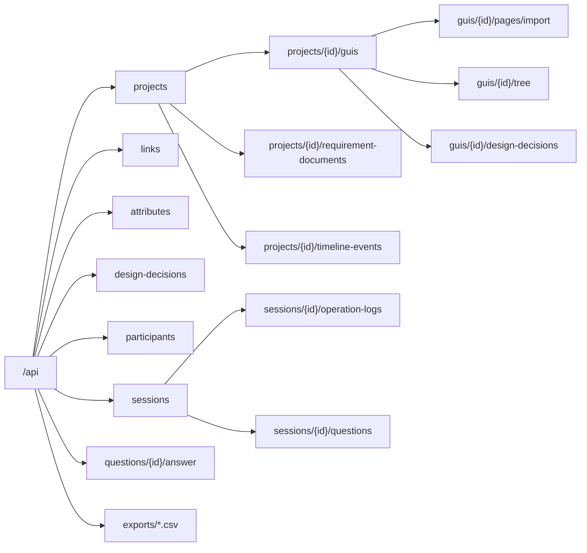

# API 設計

バックエンド（Express）の API の一覧と、共通の約束ごと。データの定義は [`docs/domain.md`](./domain.md) と [`docs/db-schema.md`](./db-schema.md) を正とする。

**各エンドポイントを実装する Issue は1つだけ**とし、§6 の対応表で決める。他の Issue は、実装済みのエンドポイントを呼ぶだけにする。

Issue : [[決めること] API 設計（エンドポイント一覧と担当 Issue）](https://github.com/haana12332/FinalProject/issues/4)

---

## 1. 共通の約束ごと

### 1.1 URL

- ベースは `/api`。パスは `backend/src/common/constants/Paths/Paths.ts` に定義する。
- リソース名は**小文字のケバブケースの複数形**（例：`requirement-documents`、`design-decisions`）。
- **入れ子は1段まで**（shallow nesting）。
  - 一覧と作成は親の下に置く：`GET /api/projects/{project_id}/guis`
  - 1件の取得・更新・削除は、そのリソースの直下に置く：`PATCH /api/guis/{gui_id}`
- パスに動詞は入れない。CRUD で表せない操作（取り込み・割り当て・開始など）だけ、`POST .../import` のようにサブリソースとして表す。
- ID はすべて uuid。

### 1.2 リクエストとレスポンス

- 本文は JSON（`Content-Type: application/json`）。CSV 出力だけ `text/csv`。
- JSON のキーは、DB の列名と同じ**小文字のスネークケース**（例：`parent_node_id`）。
- 時刻は ISO 8601（UTC）の文字列（例：`"2026-11-05T09:00:00.000Z"`）。
- 成功時の形：

```json
{ "data": { "id": "…", "name": "T1 大学グッズ購入" } }
```

```json
{ "data": [ { "id": "…" }, { "id": "…" } ] }
```

- リクエストの検証は zod（`express-zod-safe`）で行う。スキーマは `packages/domain`（#9）のものを使い、フロントエンドと共有する。

### 1.3 HTTP ステータス

|ステータス|使う場面|
|---|---|
|200 OK|取得・更新の成功|
|201 Created|作成の成功（作成したものを `data` で返す）|
|204 No Content|削除の成功（本文なし）|
|400 Bad Request|リクエストの形が不正（zod の検証エラー）|
|401 Unauthorized|認証情報がない・無効|
|403 Forbidden|権限がない（被験者が研究者用の API を呼んだ、など）|
|404 Not Found|リソースが存在しない|
|409 Conflict|一意制約や削除制限（`restrict`）に当たった|
|422 Unprocessable Entity|形は正しいが、ドメインの規則に違反している（階層の制約、命名規則など）|
|500 Internal Server Error|想定外のエラー|

### 1.4 エラーの形

```json
{
  "error": {
    "code": "hierarchy_violation",
    "message": "page の下に organism は置けません",
    "details": [
      { "layer_name": "O_Header", "parent_layer_name": "P_ProductDetail", "rule": "page_children_must_be_template" }
    ]
  }
}
```

|項目|内容|
|---|---|
|`code`|エラーの種類。小文字のスネークケース。フロントエンドはこれで処理を分ける|
|`message`|画面にそのまま出せる日本語の説明|
|`details`|任意。複数の違反をまとめて返すときの一覧（インポートの命名規則違反など）|

|code|ステータス|内容|
|---|---|---|
|`validation_error`|400|リクエストの形が不正。`details` に zod のエラー|
|`unauthorized`|401|認証が必要|
|`forbidden`|403|権限がない|
|`not_found`|404|リソースがない|
|`conflict`|409|一意制約の違反、または削除できない（実験データが残っている、など）|
|`naming_violation`|422|レイヤー名の命名規則違反（#5）|
|`hierarchy_violation`|422|階層の制約違反（`db-schema.md` §4.2）|
|`domain_violation`|422|その他の不変条件の違反（`domain.md` の不変条件）|
|`internal_error`|500|想定外のエラー。詳細はサーバーのログにだけ出す|

今の `server.ts` のエラー処理は `{ error: message, errors }` を返しているので、#11 でこの形に置き換える。

### 1.5 認証と権限

|利用者|認証の方法|付けるヘッダー|
|---|---|---|
|研究者|Supabase Auth でログインし、そのアクセストークンを使う|`Authorization: Bearer <Supabase のアクセストークン>`|
|被験者|実験用の ID（例：`P01`）を入力すると、バックエンドがセッション用のトークンを発行する（§3.9）|`Authorization: Bearer <セッショントークン>`|

- バックエンドはトークンを検証し、`users.role` で権限を判断する。
- 被験者が使えるのは、§2 の表で「被験者」に ○ が付いた API だけ。さらに、**自分のセッションに割り当てられたプロジェクトのデータだけ**を読める。
- 被験者の認証方法は #6（実験運用仕様）で確定する。変わった場合はこの節を直す。

### 1.6 被験者に見せる範囲

実験の2条件（時系列 / 構造型）で、被験者に見える情報を揃えるため、次のように絞る。

|データ|研究者|被験者（構造型）|被験者（時系列）|
|---|:-:|:-:|:-:|
|GUI の構造と Figma 由来の属性|○|○|○|
|状態遷移リンクと、プロトタイプの再生に必要な属性（`trigger`・`transition_method`）|○|○|○|
|研究者が入力した属性（`source = manual`。上の2つを除く）と設計時の判断|○|○|×|
|時系列データ|○|×|○|

この判定はバックエンドで行い、フロントエンドの表示の切り替えだけに頼らない。2条件で何を揃えるかは #7 で確定する。

---

## 2. エンドポイント一覧

「被験者」列が ○ の API は、被験者のトークンでも呼べる（§1.5・§1.6 の範囲に限る）。

### 2.1 共通

|メソッド|パス|内容|被験者|担当|
|---|---|---|:-:|---|
|GET|`/api/health`|死活確認（認証なし）|○|#11|
|GET|`/api/me`|ログイン中のユーザー|○|#11|

### 2.2 プロジェクト・GUI・ページ

|メソッド|パス|内容|被験者|担当|
|---|---|---|:-:|---|
|GET|`/api/projects`|プロジェクトの一覧||#17|
|POST|`/api/projects`|プロジェクトの作成||#17|
|GET|`/api/projects/{project_id}`|プロジェクトの取得|○|#17|
|PATCH|`/api/projects/{project_id}`|プロジェクトの更新||#17|
|DELETE|`/api/projects/{project_id}`|プロジェクトの削除（セッションがあれば 409）||#17|
|GET|`/api/projects/{project_id}/guis`|GUI の一覧（ページの一覧を含む）|○|#17|
|POST|`/api/projects/{project_id}/guis`|GUI の作成||#17|
|PATCH|`/api/guis/{gui_id}`|GUI の更新||#17|
|DELETE|`/api/guis/{gui_id}`|GUI の削除||#17|
|DELETE|`/api/pages/{page_node_id}`|ページ（とその配下）の削除||#17|

### 2.3 取り込みと GUI の構造

|メソッド|パス|内容|被験者|担当|
|---|---|---|:-:|---|
|POST|`/api/guis/{gui_id}/pages/import`|ページの取り込み（§4 の一括登録）||#18|
|PUT|`/api/pages/{page_node_id}/import`|同じページの取り込み直し（扱いは #5 で決める）||#18|
|GET|`/api/guis/{gui_id}/tree`|GUI の構造（ノード・属性・リンク）をまとめて取得|○|#18|
|PATCH|`/api/pages/{page_node_id}/position`|ページの位置（`x`・`y`）の更新||#23|

`GET /api/guis/{gui_id}/tree` は、キャンバス（#14）・レイヤーパネル（#16）・プロパティパネル（#19）・デザイン画面（#20）・プロトタイプ（#25）がすべて使う。**これらの Issue では、GUI の構造を取得する API を新しく作らない。**

### 2.4 状態遷移リンクと属性

|メソッド|パス|内容|被験者|担当|
|---|---|---|:-:|---|
|POST|`/api/links`|リンクの作成（`trigger` などの属性も同時に作れる）||#24|
|PATCH|`/api/links/{link_id}`|リンクの更新||#24|
|DELETE|`/api/links/{link_id}`|リンクの削除||#24|
|POST|`/api/attributes`|研究者が入力する属性の作成（`node_id` か `link_id` のどちらか一方）||#24|
|PATCH|`/api/attributes/{attribute_id}`|属性の値の更新||#24|
|DELETE|`/api/attributes/{attribute_id}`|属性の削除||#24|

- 属性の API は、リンクの属性（#24）と設計根拠の入力（#27）の両方で使うので、先に実装する #24 が担当する。#27 はこれを呼ぶ。
- `source = figma` の属性は API から変更・削除できない（422 `domain_violation`）。Figma 由来の値は取り込み直しでだけ変わる。

### 2.5 設計時の判断

|メソッド|パス|内容|被験者|担当|
|---|---|---|:-:|---|
|GET|`/api/guis/{gui_id}/design-decisions`|GUI の設計時の判断と、研究者が入力した属性の一覧|○（構造型のみ）|#26|
|POST|`/api/design-decisions`|判断の作成||#27|
|PATCH|`/api/design-decisions/{design_decision_id}`|判断の更新||#27|
|DELETE|`/api/design-decisions/{design_decision_id}`|判断の削除||#27|

### 2.6 要件定義書

|メソッド|パス|内容|被験者|担当|
|---|---|---|:-:|---|
|GET|`/api/projects/{project_id}/requirement-documents`|要件書の一覧|○|#21|
|POST|`/api/projects/{project_id}/requirement-documents`|要件書の作成||#21|
|GET|`/api/requirement-documents/{requirement_document_id}`|要件書の取得|○|#21|
|PATCH|`/api/requirement-documents/{requirement_document_id}`|要件書の更新||#21|
|DELETE|`/api/requirement-documents/{requirement_document_id}`|要件書の削除||#21|

### 2.7 時系列データ

|メソッド|パス|内容|被験者|担当|
|---|---|---|:-:|---|
|POST|`/api/projects/{project_id}/timeline-events/import`|時系列データの取り込み（既存の分を置き換える）||#28|
|DELETE|`/api/projects/{project_id}/timeline-events`|時系列データの全削除||#28|
|GET|`/api/projects/{project_id}/timeline-events`|時系列データの一覧（`step_index` の順）|○（時系列のみ）|#29|

### 2.8 被験者とセッション

|メソッド|パス|内容|被験者|担当|
|---|---|---|:-:|---|
|GET|`/api/participants`|被験者の一覧||#30|
|POST|`/api/participants`|被験者の登録（複数まとめて登録できる）||#30|
|DELETE|`/api/participants/{user_id}`|被験者の削除（セッションがあれば 409）||#30|
|POST|`/api/sessions/assign`|ラテン方格に従ってセッションを作る||#30|
|GET|`/api/sessions`|セッションの一覧（`?participant_id=` で絞り込み）||#30|
|DELETE|`/api/sessions/{session_id}`|セッションの削除（ログ・質問があれば 409）||#30|
|POST|`/api/participant-auth/login`|被験者が ID を入力し、セッショントークンと自分のセッションを受け取る|○|#30|
|GET|`/api/me/sessions`|自分に割り当てられたセッションの一覧|○|#30|
|POST|`/api/sessions/{session_id}/start`|セッションの開始（`started_at` を記録）|○|#33|
|POST|`/api/sessions/{session_id}/end`|セッションの終了（`ended_at` を記録）|○|#33|

### 2.9 操作ログ

|メソッド|パス|内容|被験者|担当|
|---|---|---|:-:|---|
|POST|`/api/sessions/{session_id}/operation-logs`|操作ログをまとめて保存（配列で送る）|○|#13|

画面を離れるときの送信には、`sendBeacon` ではなく `fetch(..., { keepalive: true })` を使う。`sendBeacon` は `Authorization` ヘッダーを付けられないため。

### 2.10 質問と回答

|メソッド|パス|内容|被験者|担当|
|---|---|---|:-:|---|
|POST|`/api/sessions/{session_id}/questions`|質問の作成・送信|○|#31|
|GET|`/api/sessions/{session_id}/questions`|セッションの質問と回答の一覧|○|#32|
|PUT|`/api/questions/{question_id}/answer`|回答の保存・送信（1つの質問に回答は1つ）|○|#32|
|GET|`/api/questions`|質問と回答の一覧（研究者用。`?project_id=`・`?session_id=` で絞り込み）||#34|

質問を送信後に編集できるかは #6 で決める。編集できる場合は `PATCH /api/questions/{question_id}` を #31 に追加する。

### 2.11 CSV 出力

|メソッド|パス|内容|被験者|担当|
|---|---|---|:-:|---|
|GET|`/api/exports/operation-logs.csv`|操作ログの CSV（`?session_id=` または `?project_id=`、なければ全件）||#34|
|GET|`/api/exports/questions.csv`|質問と回答の CSV（絞り込みは同上）||#34|

---

## 3. 主なリクエストとレスポンス

### 3.1 GUI の構造の取得

`GET /api/guis/{gui_id}/tree`

入れ子にせず、テーブルごとの配列で返す。木構造は `parent_node_id` をもとにフロントエンドで組み立てる。

```json
{
  "data": {
    "gui": { "id": "…", "project_id": "…", "name": "大学生協 EC サイト", "description": null },
    "nodes": [
      { "id": "n-page", "parent_node_id": null, "layer_name": "P_ProductDetail", "layer_type": "page", "node_kind": "frame", "sort_order": 0 },
      { "id": "n-body", "parent_node_id": "n-page", "layer_name": "T_Body", "layer_type": "template", "node_kind": "frame", "sort_order": 1 }
    ],
    "attributes": [
      { "id": "…", "node_id": "n-body", "link_id": null, "attribute_type": "y", "value": 80, "source": "figma" }
    ],
    "links": [
      { "id": "…", "source_node_id": "…", "target_node_id": "…", "name": "商品詳細へ" }
    ]
  }
}
```

### 3.2 リンクの作成

`POST /api/links`

```json
{
  "source_node_id": "…",
  "target_node_id": "…",
  "name": "商品詳細へ",
  "attributes": [
    { "attribute_type": "trigger", "value": "click" },
    { "attribute_type": "transition_method", "value": "replace" }
  ]
}
```

リンクと属性は1つのトランザクションで保存する（§4 と同じ方法）。

### 3.3 設計時の判断の作成

`POST /api/design-decisions`

```json
{
  "attribute_id": "…",
  "determine_type": "static_property",
  "comments": "親（Main）の左右の余白 160px に合わせて x を決めた"
}
```

`determine_type` が属性の `attribute_type` に対応しない場合は、422 `domain_violation` を返す。

### 3.4 被験者のログイン

`POST /api/participant-auth/login`

```json
{ "name": "P01" }
```

```json
{
  "data": {
    "token": "…",
    "user": { "id": "…", "name": "P01", "role": "participant" },
    "sessions": [
      { "id": "…", "project_id": "…", "method": "structural", "order_index": 1, "started_at": null, "ended_at": null }
    ]
  }
}
```

### 3.5 操作ログの保存

`POST /api/sessions/{session_id}/operation-logs`

```json
{
  "logs": [
    { "event_type": "object_select", "target_node_id": "…", "payload": { "layer_type": "organism" }, "occurred_at": "2026-11-05T09:00:01.120Z" },
    { "event_type": "zoom", "target_node_id": null, "payload": { "scale": 1.5 }, "occurred_at": "2026-11-05T09:00:02.004Z" }
  ]
}
```

`event_type` の一覧と `payload` の形は #6 で決め、`packages/domain` に定義する。

---

## 4. 一括登録（取り込み）の形

`POST /api/guis/{gui_id}/pages/import`

SVG はフロントエンドで読み（#18）、ノードの木と属性に変換してから送る。**1ページ分を1回のリクエストで送り、1つのトランザクションで保存する。** 途中でエラーになったら何も保存しない。

```json
{
  "nodes": [
    {
      "ref": "1",
      "parent_ref": null,
      "layer_name": "P_ProductDetail",
      "layer_type": "page",
      "node_kind": "frame",
      "sort_order": 0,
      "attributes": [
        { "attribute_type": "x", "value": 0 },
        { "attribute_type": "y", "value": 0 },
        { "attribute_type": "width", "value": 1920 },
        { "attribute_type": "height", "value": 1800 }
      ]
    },
    {
      "ref": "2",
      "parent_ref": "1",
      "layer_name": "T_Body",
      "layer_type": "template",
      "node_kind": "frame",
      "sort_order": 1,
      "attributes": [
        { "attribute_type": "y", "value": 80 }
      ]
    }
  ]
}
```

- **`ref` / `parent_ref`**：リクエストの中だけで使う仮の番号。ノードの uuid はまだないので、親子関係はこれで表す。保存時にバックエンドが uuid に置き換える。
- 取り込みで作る属性は、すべて `source = figma`。
- **検証の順番**：
  1. zod でリクエストの形を検証する（400 `validation_error`）
  2. `packages/domain` で、命名規則（422 `naming_violation`）・階層の制約（422 `hierarchy_violation`）・属性の種類と値の形（422 `domain_violation`）を検証する。違反はすべて集めて `details` で一度に返す
  3. DB に保存する。DB のトリガーや制約でエラーになった場合も、同じエラーの形に変換して返す
- **トランザクションの実現方法**：Supabase の JS クライアントは、複数の SQL を1つのトランザクションにまとめられない。そこで、取り込みを行う PostgreSQL の関数（例：`import_page(gui_id uuid, payload jsonb)`）を作り、バックエンドから `supabase.rpc('import_page', …)` で呼ぶ。この関数のマイグレーションは #18 で追加する。
- **レスポンス**：201。作成したページを §3.1 と同じ形（そのページの分の `nodes` と `attributes`）で返す。

時系列データの取り込み（`POST /api/projects/{project_id}/timeline-events/import`）とリンクの作成（§3.2）も、同じく PostgreSQL の関数で1つのトランザクションにする。

---

## 5. リソースの構成



---

## 6. 担当 Issue の対応表

|担当|エンドポイント数|エンドポイント|
|---|:-:|---|
|#11 バックエンド基盤|2|`GET /health`、`GET /me`（研究者の認証の仕組みとエラーの形も含む）|
|#13 操作ログの記録基盤|1|`POST /sessions/{id}/operation-logs`|
|#17 プロジェクトとページの管理|10|projects の CRUD、guis の一覧・作成・更新・削除、`DELETE /pages/{id}`|
|#18 GUI 成果物のインポート|3|`POST /guis/{id}/pages/import`、`PUT /pages/{id}/import`、`GET /guis/{id}/tree`|
|#21 要件定義書の登録と閲覧|5|requirement-documents の CRUD|
|#23 ページ層の移動|1|`PATCH /pages/{id}/position`|
|#24 状態遷移リンクの作成|6|links の作成・更新・削除、attributes の作成・更新・削除|
|#26 設計根拠の表示|1|`GET /guis/{id}/design-decisions`|
|#27 設計根拠の入力|3|design-decisions の作成・更新・削除|
|#28 時系列データの取り込み|2|timeline-events の取り込み・全削除|
|#29 時系列ビュー|1|`GET /projects/{id}/timeline-events`|
|#30 被験者 ID と検証パターンの割り当て|8|participants、sessions の割り当て・一覧・削除、被験者のログイン、`GET /me/sessions`|
|#31 質問の作成と送信|1|`POST /sessions/{id}/questions`|
|#32 質問への回答|2|`GET /sessions/{id}/questions`、`PUT /questions/{id}/answer`|
|#33 被験者セッションの画面フロー|2|`POST /sessions/{id}/start`、`POST /sessions/{id}/end`|
|#34 CSV 出力|3|`GET /questions`、`GET /exports/operation-logs.csv`、`GET /exports/questions.csv`|
||**51**||

API を持たない Issue：#14 キャンバス、#15 選択、#16 レイヤーパネル、#19 プロパティパネル、#20 デザイン画面、#22 ペースト（#18 の取り込み API を呼ぶ）、#25 プロトタイプ、#35 通しテスト。

---

## 7. 未決事項

- **被験者の認証方法**（§1.5）：ID の入力だけでよいか。#6 で確定する。
- **被験者に見せる範囲**（§1.6）：2条件で何を揃えるか。#7 で確定する。
- **取り込み直し**（`PUT /api/pages/{id}/import`）：ノードの ID を保つか、作り直すか。作り直すと、実験を始めたあとのログの `target_node_id` が `null` になる（`db-schema.md` §5）。#5 で決める。
- **担当の追加**：研究者の認証（`GET /me`）とエラーの形の置き換えは #11、`keepalive` を使ったログ送信は #13 の作業になる。それぞれの Issue の本文にも追記する。
