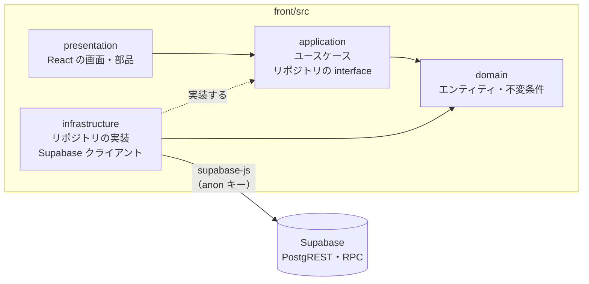

# Supabase アクセス設計

**バックエンドは作らない。** フロントエンド（React）の infrastructure 層から、Supabase に直接アクセスする。このドキュメントでは、そのときに使う「エンドポイント」を決める。具体的には次の4つである。

- テーブルへのアクセス（Supabase の REST API ＝ PostgREST）
- RPC 関数（PostgreSQL の関数）
- エラーの扱い
- 担当 Issue

**セキュリティ（ログイン・権限・RLS）は扱わない**（研究用の実験ツールで、外部に公開しないため）。

データの定義は [`docs/domain.md`](./domain.md) と [`docs/db-schema.md`](./db-schema.md) を正とする。

**各データアクセスを実装する Issue は1つだけ**とし、§7 の対応表で決める。他の Issue は、実装済みのリポジトリを呼ぶだけにする。

Issue : [[決めること] Supabase アクセス設計](https://github.com/haana12332/FinalProject/issues/4)

---

## 1. 構成

### 1.1 層と依存の向き（クリーンアーキテクチャ）



|層|置き場所|持つもの|
|---|---|---|
|domain|`front/src/domain`|エンティティ・値オブジェクト・不変条件の検証関数（#9）。React と Supabase に依存しない|
|application|`front/src/application`|ユースケースと、リポジトリの interface（例：`ProjectRepository`）|
|infrastructure|`front/src/infrastructure`|リポジトリの実装（`SupabaseProjectRepository` など）、Supabase クライアント、生成した DB の型、CSV 出力|
|presentation|`front/src/presentation`|画面と部品。ユースケースを呼ぶだけで、Supabase を直接呼ばない|

- **Supabase を呼んでよいのは `front/src/infrastructure` だけ。** presentation と application から `supabase-js` を import しない（ESLint の `no-restricted-imports` で禁止する）。
- リポジトリは「1つのテーブル（または集約）につき1つ」作り、置き場所は `front/src/infrastructure/supabase/repositories/` にする。

### 1.2 Supabase クライアント

- `front/src/infrastructure/supabase/client.ts` に1つだけ作る（#11）。
- 使うのは **anon キー**だけ。URL とキーは `VITE_SUPABASE_URL` / `VITE_SUPABASE_ANON_KEY` の環境変数で渡す。
- RLS は使わない（§4）。anon キーだけで、すべてのテーブルを読み書きできる。
- DB の型は `supabase gen types typescript` で `front/src/infrastructure/supabase/types.ts` に生成し（#10）、`createClient<Database>()` に渡す。

### 1.3 「エンドポイント」の種類

|種類|使う場面|supabase-js の呼び方|実際の HTTP|
|---|---|---|---|
|テーブル操作|1つのテーブルの一覧・取得・作成・更新・削除|`supabase.from('projects').select()` など|`GET/POST/PATCH/DELETE /rest/v1/projects`|
|RPC 関数|複数のテーブルを1トランザクションで書く処理、複数のテーブルをまとめて読む処理|`supabase.rpc('import_page', { … })`|`POST /rest/v1/rpc/import_page`|
|Storage|画像ファイル（`image_ref` の参照先）|`supabase.storage.from('images')`|`/storage/v1/...`|

supabase-js は、複数の SQL を1つのトランザクションにまとめられない。**複数のテーブル・複数の行を「全部保存するか、何も保存しないか」にしたい処理は、必ず RPC 関数にする。**

---

## 2. 共通の約束ごと

- リポジトリのメソッドは `async` で、ドメインの型（`front/src/domain`）を返す。DB の行の型（`types.ts`）を presentation に漏らさない。
- 列名・キーは DB と同じ小文字のスネークケース。ドメインの型も同じ名前にそろえ、変換の手間をなくす。
- 時刻は DB の `timestamptz` を ISO 8601 の文字列として受け取る。
- 1回の `select` で返る行数には上限がある（既定 1000 行）。操作ログの CSV 出力など大量の行を読む処理は、`range()` で分けて読む。
- 保存の前に、`front/src/domain` の検証関数で不変条件を確認する。DB の制約・トリガーでも二重に守る。

### 2.1 エラーの変換

Supabase から返るエラーを、infrastructure 層でアプリのエラー（`AppError`）に変換する（#11）。presentation は `AppError.code` だけを見て表示を分ける。

```ts
type AppError = {
  code: 'not_found' | 'conflict'
      | 'naming_violation' | 'hierarchy_violation' | 'domain_violation'
      | 'network_error' | 'internal_error'
  message: string        // 画面にそのまま出せる日本語
  details?: unknown[]    // 複数の違反をまとめて返すとき（取り込みの命名規則違反など）
}
```

|Supabase のエラー|code|内容|
|---|---|---|
|`PGRST116`（`single()` で行がない）|`not_found`|データがない|
|`23505`（一意制約違反）・`23503`（外部キー違反。`restrict` で削除できない場合を含む）|`conflict`|重複している、または関連するデータがあるので消せない|
|`DR001`（階層のトリガー。§2.2）|`hierarchy_violation`|階層の制約違反|
|`DR002`（RPC 関数の命名規則違反）|`naming_violation`|レイヤー名の命名規則違反|
|`23514`（CHECK 制約違反）・`DR003`（RPC 関数のその他の規則違反）|`domain_violation`|その他の不変条件の違反|
|`fetch` の失敗|`network_error`|通信できない|
|上記以外|`internal_error`|想定外のエラー。詳細はコンソールにだけ出す|

### 2.2 独自のエラーコード

トリガーや RPC 関数で規則違反を検出したときは、`raise exception ... using errcode = 'DR001'` のように独自の SQLSTATE を付ける。メッセージの文字列ではなくコードで判定できるようにするためである。`detail` に JSON を入れると、`AppError.details` として受け取れる。

|SQLSTATE|意味|
|---|---|
|`DR001`|階層の制約違反（`db-schema.md` §4.2 のトリガー）|
|`DR002`|命名規則違反（取り込み）|
|`DR003`|その他のドメインの規則違反|

---

## 3. 被験者の識別

**ログインはしない。** 研究者用の画面には、誰でもそのまま入れる。

- 被験者は、開始画面で実験用の ID（例：`P01`）を入力する。`ParticipantRepository.findByName` で `users` の行を探し、見つかれば自分に割り当てられたセッションを表示する（#30）。
- 選んだセッションの情報（`participant_id`・`session_id`・`project_id`・`method`）は、画面の状態（`SessionContext`、#13）として持つ。リロードしても続けられるよう、`sessionStorage` にも保存する。

---

## 4. 実験の条件ごとに見せる範囲

**RLS は使わない。** すべてのテーブルで RLS を無効にする。

ただし、実験の2条件（時系列 / 構造型）で被験者に見える情報をそろえることは、セキュリティではなく実験の妥当性のために必要である。そこで、**被験者の画面では、セッションの `method` に応じて取得するデータを application 層で絞る。**

|データ|研究者|被験者（構造型）|被験者（時系列）|
|---|:-:|:-:|:-:|
|GUI の構造と Figma 由来の属性|○|○|○|
|状態遷移リンクと、プロトタイプの再生に必要な属性（`trigger`・`transition_method`）|○|○|○|
|研究者が入力した属性（`source = manual`。上の2つを除く）と設計時の判断|○|○|×|
|時系列データ|○|×|○|

- 判定は `front/src/application/session/visibleScope.ts` の `visibleScopeFor(method)` に1か所だけ置く（#33）。各ユースケースは、これが返す範囲だけを取得する。
- 被験者の画面では、見せないデータは**取得そのものをしない**（取得してから画面で隠すのではない）。`get_gui_tree` には `include_manual` 引数を付け、時系列の条件では `false` で呼ぶ（#18）。
- 2条件で何をそろえるかは #7 で確定する。

---

## 5. RPC 関数

|関数|内容|担当|
|---|---|---|
|`get_gui_tree(gui_id, include_manual)`|GUI のノード・属性・リンクをまとめて返す（§6.1）。`include_manual = false` のときは、研究者が入力した属性を `trigger`・`transition_method` 以外は返さない（§4）|#18|
|`import_page(gui_id, payload)`|1ページ分のノードと属性を1トランザクションで保存する（§6.2）|#18|
|`reimport_page(page_node_id, payload)`|同じページの取り込み直し（扱いは #5 で決める）|#18|
|`update_page_position(page_node_id, x, y)`|ページの `x`・`y` 属性をまとめて更新する|#23|
|`create_link(payload)`|リンクと、その属性（`trigger` など）を1トランザクションで作る|#24|
|`get_design_decisions(gui_id)`|GUI の設計時の判断と、紐づく属性の一覧|#26|
|`import_timeline_events(project_id, events)`|時系列データを置き換える（全削除してから追加）|#28|
|`assign_sessions(participant_ids, project_ids)`|ラテン方格に従ってセッションを作る|#30|

- 規則違反は、§2.2 のエラーコードで `raise exception` する。
- それぞれの関数のマイグレーションは、担当の Issue の PR で追加する。

---

## 6. 主な入出力

### 6.1 GUI の構造の取得

`supabase.rpc('get_gui_tree', { gui_id, include_manual })`

入れ子にせず、テーブルごとの配列で返す。木構造は `parent_node_id` をもとに domain 層で組み立てる。

```json
{
  "gui": { "id": "…", "project_id": "…", "name": "大学生協 EC サイト", "description": null },
  "nodes": [
    { "id": "n-page", "parent_node_id": null, "layer_name": "P_ProductDetail", "layer_type": "page", "node_kind": "frame", "sort_order": 0 },
    { "id": "n-body", "parent_node_id": "n-page", "layer_name": "T_Body", "layer_type": "template", "node_kind": "frame", "sort_order": 1 }
  ],
  "attributes": [
    { "id": "…", "node_id": "n-body", "link_id": null, "attribute_type": "y", "value": 80, "source": "figma" }
  ],
  "links": [
    { "id": "…", "source_node_id": "…", "target_node_id": "…", "name": "商品詳細へ" }
  ]
}
```

キャンバス（#14）・レイヤーパネル（#16）・プロパティパネル（#19）・デザイン画面（#20）・プロトタイプ（#25）は、すべてこれを使う。**これらの Issue では、GUI の構造を取得する処理を新しく作らない。**

### 6.2 ページの取り込み（一括登録）

`supabase.rpc('import_page', { gui_id, payload })`

SVG はフロントエンド（`front/src/application/import`、#18）で読み、ノードの木と属性に変換してから渡す。**1ページ分を1回の呼び出しで渡し、1つのトランザクションで保存する。** 途中でエラーになったら何も保存しない。

```json
{
  "nodes": [
    {
      "ref": "1",
      "parent_ref": null,
      "layer_name": "P_ProductDetail",
      "layer_type": "page",
      "node_kind": "frame",
      "sort_order": 0,
      "attributes": [
        { "attribute_type": "x", "value": 0 },
        { "attribute_type": "y", "value": 0 },
        { "attribute_type": "width", "value": 1920 },
        { "attribute_type": "height", "value": 1800 }
      ]
    },
    {
      "ref": "2",
      "parent_ref": "1",
      "layer_name": "T_Body",
      "layer_type": "template",
      "node_kind": "frame",
      "sort_order": 1,
      "attributes": [ { "attribute_type": "y", "value": 80 } ]
    }
  ]
}
```

- **`ref` / `parent_ref`**：この呼び出しの中だけで使う仮の番号。ノードの uuid はまだないので、親子関係はこれで表す。関数の中で uuid に置き換える。
- 取り込みで作る属性は、すべて `source = 'figma'`。
- **検証の順番**：
  1. 呼び出す前に、`front/src/domain` で命名規則・階層の制約・属性の種類と値の形を検証する。違反はすべて集め、保存せずに一覧で表示する
  2. 関数の中でも、命名規則（`DR002`）と階層の制約（トリガーの `DR001`）を確認する。ブラウザ側の検証に漏れがあっても、不正なデータが入らないようにするため
- **戻り値**：作成したページの分の `nodes` と `attributes`（§6.1 と同じ形）。

### 6.3 操作ログの保存

`supabase.from('operation_logs').insert(logs)`

```json
[
  { "session_id": "…", "event_type": "object_select", "target_node_id": "…", "payload": { "layer_type": "organism" }, "occurred_at": "2026-11-05T09:00:01.120Z" },
  { "session_id": "…", "event_type": "zoom", "target_node_id": null, "payload": { "scale": 1.5 }, "occurred_at": "2026-11-05T09:00:02.004Z" }
]
```

- ログはバッファにためて、まとめて `insert` する（#13）。
- 画面を離れるとき（`visibilitychange` で `hidden` になったとき）は、残りを送り切る。`sendBeacon` は Supabase に必要な `apikey` ヘッダーを付けられないので使わない。代わりに、`fetch` に `keepalive: true` を付けたログ専用のクライアント（`createClient(url, key, { global: { fetch } })`）で送る。`keepalive` は1回あたり 64KB までなので、分けて送る。
- `event_type` の一覧と `payload` の形は #6 で決め、`front/src/domain` に定義する。

---

## 7. データアクセスの一覧と担当 Issue

「被験者」列が ○ のものは、被験者の画面でも使う（§4 の範囲に限る）。

### 7.1 認証

ログインはしないので、認証のデータアクセスはない（§3）。

### 7.2 プロジェクト・GUI・ページ

|リポジトリのメソッド|Supabase の呼び方|HTTP|被験者|担当|
|---|---|---|:-:|---|
|`ProjectRepository.list`|`from('projects').select()`|`GET /rest/v1/projects`||#17|
|`ProjectRepository.get`|`from('projects').select().eq('id', id).single()`|`GET /rest/v1/projects`|○|#17|
|`ProjectRepository.create`|`from('projects').insert()`|`POST /rest/v1/projects`||#17|
|`ProjectRepository.update`|`from('projects').update().eq('id', id)`|`PATCH /rest/v1/projects`||#17|
|`ProjectRepository.delete`|`from('projects').delete().eq('id', id)`|`DELETE /rest/v1/projects`||#17|
|`GuiRepository.listByProject`|`from('guis').select('*, nodes(id, layer_name)').eq('project_id', id).eq('nodes.layer_type', 'page')`|`GET /rest/v1/guis`|○|#17|
|`GuiRepository.create`|`from('guis').insert()`|`POST /rest/v1/guis`||#17|
|`GuiRepository.update`|`from('guis').update().eq('id', id)`|`PATCH /rest/v1/guis`||#17|
|`GuiRepository.delete`|`from('guis').delete().eq('id', id)`|`DELETE /rest/v1/guis`||#17|
|`GuiRepository.deletePage`|`from('nodes').delete().eq('id', id).eq('layer_type', 'page')`|`DELETE /rest/v1/nodes`||#17|

### 7.3 取り込みと GUI の構造

|リポジトリのメソッド|Supabase の呼び方|HTTP|被験者|担当|
|---|---|---|:-:|---|
|`GuiTreeRepository.importPage`|`rpc('import_page')`|`POST /rest/v1/rpc/import_page`||#18|
|`GuiTreeRepository.reimportPage`|`rpc('reimport_page')`|`POST /rest/v1/rpc/reimport_page`||#18|
|`GuiTreeRepository.getTree`|`rpc('get_gui_tree')`|`POST /rest/v1/rpc/get_gui_tree`|○|#18|
|`GuiTreeRepository.updatePagePosition`|`rpc('update_page_position')`|`POST /rest/v1/rpc/update_page_position`||#23|

### 7.4 状態遷移リンクと属性

|リポジトリのメソッド|Supabase の呼び方|HTTP|被験者|担当|
|---|---|---|:-:|---|
|`LinkRepository.create`|`rpc('create_link')`|`POST /rest/v1/rpc/create_link`||#24|
|`LinkRepository.update`|`from('links').update().eq('id', id)`|`PATCH /rest/v1/links`||#24|
|`LinkRepository.delete`|`from('links').delete().eq('id', id)`|`DELETE /rest/v1/links`||#24|
|`AttributeRepository.create`|`from('attributes').insert()`（`source = 'manual'`）|`POST /rest/v1/attributes`||#24|
|`AttributeRepository.update`|`from('attributes').update().eq('id', id)`|`PATCH /rest/v1/attributes`||#24|
|`AttributeRepository.delete`|`from('attributes').delete().eq('id', id)`|`DELETE /rest/v1/attributes`||#24|

属性のリポジトリは、リンクの属性（#24）と設計根拠の入力（#27）の両方で使うので、先に実装する #24 が担当する。#27 はこれを呼ぶ。

### 7.5 設計時の判断

|リポジトリのメソッド|Supabase の呼び方|HTTP|被験者|担当|
|---|---|---|:-:|---|
|`DesignDecisionRepository.listByGui`|`rpc('get_design_decisions')`|`POST /rest/v1/rpc/get_design_decisions`|○（構造型のみ）|#26|
|`DesignDecisionRepository.create`|`from('design_decisions').insert()`|`POST /rest/v1/design_decisions`||#27|
|`DesignDecisionRepository.update`|`from('design_decisions').update().eq('id', id)`|`PATCH /rest/v1/design_decisions`||#27|
|`DesignDecisionRepository.delete`|`from('design_decisions').delete().eq('id', id)`|`DELETE /rest/v1/design_decisions`||#27|

### 7.6 要件定義書

|リポジトリのメソッド|Supabase の呼び方|HTTP|被験者|担当|
|---|---|---|:-:|---|
|`RequirementDocumentRepository.listByProject`|`from('requirement_documents').select().eq('project_id', id)`|`GET /rest/v1/requirement_documents`|○|#21|
|`RequirementDocumentRepository.get`|`from('requirement_documents').select().eq('id', id).single()`|`GET /rest/v1/requirement_documents`|○|#21|
|`RequirementDocumentRepository.create`|`from('requirement_documents').insert()`|`POST /rest/v1/requirement_documents`||#21|
|`RequirementDocumentRepository.update`|`from('requirement_documents').update().eq('id', id)`|`PATCH /rest/v1/requirement_documents`||#21|
|`RequirementDocumentRepository.delete`|`from('requirement_documents').delete().eq('id', id)`|`DELETE /rest/v1/requirement_documents`||#21|

### 7.7 時系列データ

|リポジトリのメソッド|Supabase の呼び方|HTTP|被験者|担当|
|---|---|---|:-:|---|
|`TimelineEventRepository.importEvents`|`rpc('import_timeline_events')`|`POST /rest/v1/rpc/import_timeline_events`||#28|
|`TimelineEventRepository.deleteAll`|`from('timeline_events').delete().eq('project_id', id)`|`DELETE /rest/v1/timeline_events`||#28|
|`TimelineEventRepository.listByProject`|`from('timeline_events').select().eq('project_id', id).order('step_index')`|`GET /rest/v1/timeline_events`|○（時系列のみ）|#29|

### 7.8 被験者とセッション

|リポジトリのメソッド|Supabase の呼び方|HTTP|被験者|担当|
|---|---|---|:-:|---|
|`ParticipantRepository.list`|`from('users').select().eq('role', 'participant')`|`GET /rest/v1/users`||#30|
|`ParticipantRepository.create`|`from('users').insert()`（複数まとめて）|`POST /rest/v1/users`||#30|
|`ParticipantRepository.delete`|`from('users').delete().eq('id', id)`|`DELETE /rest/v1/users`||#30|
|`SessionRepository.assign`|`rpc('assign_sessions')`|`POST /rest/v1/rpc/assign_sessions`||#30|
|`SessionRepository.list`|`from('sessions').select()`|`GET /rest/v1/sessions`||#30|
|`SessionRepository.delete`|`from('sessions').delete().eq('id', id)`|`DELETE /rest/v1/sessions`||#30|
|`ParticipantRepository.findByName`|`from('users').select().eq('role', 'participant').eq('name', name).single()`|`GET /rest/v1/users`|○|#30|
|`SessionRepository.listByParticipant`|`from('sessions').select().eq('participant_id', id).order('order_index')`|`GET /rest/v1/sessions`|○|#30|
|`SessionRepository.start`|`from('sessions').update({ started_at }).eq('id', id)`|`PATCH /rest/v1/sessions`|○|#33|
|`SessionRepository.end`|`from('sessions').update({ ended_at }).eq('id', id)`|`PATCH /rest/v1/sessions`|○|#33|

### 7.9 操作ログ

|リポジトリのメソッド|Supabase の呼び方|HTTP|被験者|担当|
|---|---|---|:-:|---|
|`OperationLogRepository.insertMany`|`from('operation_logs').insert(logs)`|`POST /rest/v1/operation_logs`|○|#13|

### 7.10 質問と回答

|リポジトリのメソッド|Supabase の呼び方|HTTP|被験者|担当|
|---|---|---|:-:|---|
|`QuestionRepository.create`|`from('questions').insert()`|`POST /rest/v1/questions`|○|#31|
|`QuestionRepository.listBySession`|`from('questions').select('*, answers(*)').eq('session_id', id)`|`GET /rest/v1/questions`|○|#32|
|`AnswerRepository.save`|`from('answers').upsert({ … }, { onConflict: 'question_id' })`|`POST /rest/v1/answers`|○|#32|
|`QuestionRepository.listForResearcher`|`from('questions').select('*, answers(*), sessions(*)')`（`project_id`・`session_id` で絞り込み）|`GET /rest/v1/questions`||#34|

質問を送信後に編集できるかは #6 で決める。編集できる場合は `QuestionRepository.update` を #31 に追加する。

### 7.11 CSV 出力

CSV はブラウザで作ってダウンロードさせる（バックエンドがないため）。

|リポジトリのメソッド|Supabase の呼び方|HTTP|被験者|担当|
|---|---|---|:-:|---|
|`ExportRepository.fetchOperationLogs`|`from('operation_logs').select().order('occurred_at').range(from, to)`（1000行ずつ読む）|`GET /rest/v1/operation_logs`||#34|

CSV への変換とダウンロードは `front/src/infrastructure/csv`（#34）で行う。質問と回答の CSV は `QuestionRepository.listForResearcher` の結果から作る。

### 7.12 担当ごとの数

|担当|数|
|---|:-:|
|#13 操作ログの記録基盤|1|
|#17 プロジェクトとページの管理|10|
|#18 GUI 成果物のインポート|3|
|#21 要件定義書の登録と閲覧|5|
|#23 ページ層の移動|1|
|#24 状態遷移リンクの作成|6|
|#26 設計根拠の表示|1|
|#27 設計根拠の入力|3|
|#28 時系列データの取り込み|2|
|#29 時系列ビュー|1|
|#30 被験者 ID と検証パターンの割り当て|8|
|#31 質問の作成と送信|1|
|#32 質問への回答|2|
|#33 被験者セッションの画面フロー|2|
|#34 CSV 出力|2|
|**計**|**48**|

データアクセスを持たない Issue：#11 Supabase クライアントと infrastructure 層の基盤（クライアント・エラーの変換・リポジトリの書き方だけを作る）、#14 キャンバス、#15 選択、#16 レイヤーパネル、#19 プロパティパネル、#20 デザイン画面、#25 プロトタイプ、#35 通しテスト。

---

## 8. 未決事項

- **被験者に見せる範囲**（§4）：2条件で何をそろえるか。#7 で確定する。
- **取り込み直し**（`reimport_page`）：ノードの ID を保つか、作り直すか。作り直すと、実験を始めたあとのログの `target_node_id` が `null` になる（`db-schema.md` §5）。#5 で決める。
