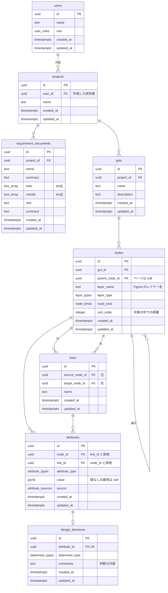
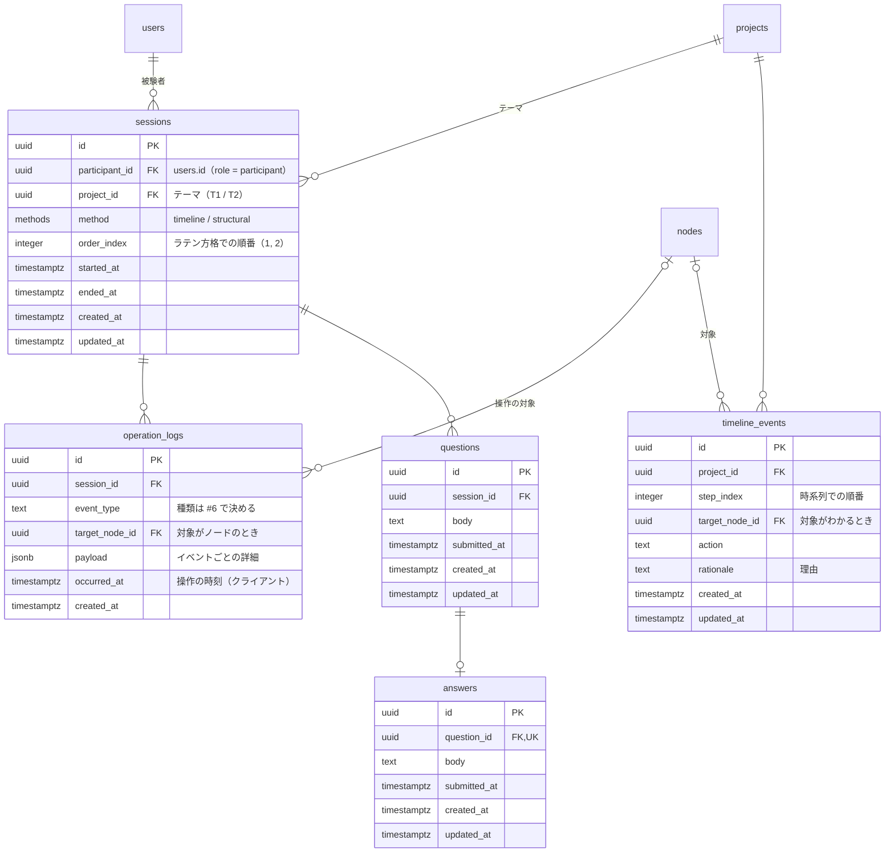

# DB スキーマ

Supabase（PostgreSQL）のテーブル定義。ドメインの定義は [`docs/domain.md`](./domain.md) を正とし、このドキュメントはそれを DB のテーブルに落としたものである。

Issue : [[決めること] DB スキーマ設計](https://github.com/haana12332/FinalProject/issues/3)

---

## 1. 保存先の範囲

以前は「DB に保存するのは GUI オブジェクト・状態遷移リンク・設計根拠の3つ」と決めていた。実験の運用に必要なデータも含め、次のように保存先を決める。

|データ|保存先|理由|
|---|---|---|
|GUI オブジェクト（ノード・属性）|DB|設計根拠を属性に外部キーで紐づけるため|
|状態遷移リンク|DB|同上|
|設計時の判断|DB|同上|
|要件定義書|DB|プロジェクトに紐づけて管理し、被験者に表示するため|
|ユーザー（研究者・被験者）|DB|セッション・ログを被験者に紐づけるため|
|セッション・操作ログ・質問・回答|DB（**案**）|被験者・セッションと外部キーで結び、CSV 出力（#34）を DB だけから行えるようにするため|
|時系列データ|DB（**案**）|プロジェクトに紐づけるため。項目は #7 で決める|
|画像ファイル（`image_ref` の参照先）|Supabase Storage|バイナリなので DB には入れない|
|文章（概要・説明・判断の内容など）|DB の `text` 列（プレーンテキスト）|Markdown などの自由な書式は使わない。構造を持つ情報は、文章に埋め込まず、列・配列・`jsonb` に決まった形で保存する|

**案** と書いたテーブル（§3.2）の列は、#6（実験運用仕様）と #7（時系列データの形式）で決まる内容に合わせて見直す。

---

## 2. ER 図

### 2.1 GUI と設計根拠（#2 のドメインモデル）



### 2.2 実験の運用（案）



---

## 3. テーブル定義

型は PostgreSQL の型で書く。`text_array` は ER 図の表記上の都合で、実際の型は `text[]`。

### 3.1 GUI と設計根拠

#### users

|列|型|NULL|既定値|説明|
|---|---|---|---|---|
|id|uuid|×|`gen_random_uuid()`|主キー|
|name|text|×||表示名。被験者は実験用の ID（例：`P01`）|
|role|user_roles|×||`researcher` / `participant`|
|created_at|timestamptz|×|`now()`||
|updated_at|timestamptz|×|`now()`||

#### projects

|列|型|NULL|既定値|説明|
|---|---|---|---|---|
|id|uuid|×|`gen_random_uuid()`|主キー|
|user_id|uuid|×||作成した研究者。`users.id`|
|name|text|×||プロジェクト名（例：T1 大学グッズ購入）|
|created_at / updated_at|timestamptz|×|`now()`||

#### requirement_documents

|列|型|NULL|既定値|説明|
|---|---|---|---|---|
|id|uuid|×|`gen_random_uuid()`|主キー|
|project_id|uuid|×||`projects.id`|
|name|text|×||要件書の名前|
|summary|text|○||概要|
|todo|text[]|×|`'{}'`|やること|
|notodo|text[]|×|`'{}'`|やらないこと|
|dod|text|○||完了条件（Definition of Done）|
|comment|text|○||補足|
|created_at / updated_at|timestamptz|×|`now()`||

#### guis

|列|型|NULL|既定値|説明|
|---|---|---|---|---|
|id|uuid|×|`gen_random_uuid()`|主キー|
|project_id|uuid|×||`projects.id`|
|name|text|×||GUI 成果物の名前|
|description|text|○||説明|
|created_at / updated_at|timestamptz|×|`now()`||

#### nodes

|列|型|NULL|既定値|説明|
|---|---|---|---|---|
|id|uuid|×|`gen_random_uuid()`|主キー|
|gui_id|uuid|×||`guis.id`|
|parent_node_id|uuid|○||親ノード。`nodes.id`。ページ（最上位）は `null`|
|layer_name|text|×||Figma のレイヤー名（例：`O_ProductCard`）|
|layer_type|layer_types|×||Atomic Design の層|
|node_kind|node_kinds|×||Figma の図形の種類|
|sort_order|integer|×||同じ親を持つ兄弟の中での順番（重なり順・レイヤーパネルの表示順）|
|created_at / updated_at|timestamptz|×|`now()`||

#### links（状態遷移リンク）

階層（`nodes.parent_node_id`）と状態遷移リンク（`links`）は、別の関係として分けて持つ。

|列|型|NULL|既定値|説明|
|---|---|---|---|---|
|id|uuid|×|`gen_random_uuid()`|主キー|
|source_node_id|uuid|×||遷移の元。`nodes.id`|
|target_node_id|uuid|×||遷移の先。`nodes.id`。同じ要素の別状態への遷移では元と同じになることがある|
|name|text|×||リンクの名前|
|created_at / updated_at|timestamptz|×|`now()`||

#### attributes

|列|型|NULL|既定値|説明|
|---|---|---|---|---|
|id|uuid|×|`gen_random_uuid()`|主キー|
|node_id|uuid|○||持ち主のノード。`nodes.id`|
|link_id|uuid|○||持ち主のリンク。`links.id`|
|attribute_type|attribute_types|×||属性の種類（`docs/domain.md`）|
|value|jsonb|○||値。形は `attribute_type` ごとに決まる（検証は `front/src/domain` の zod スキーマで行う）。値なしの属性は `null`|
|source|attribute_sources|×||`figma` / `manual`|
|created_at / updated_at|timestamptz|×|`now()`||

#### design_decisions

|列|型|NULL|既定値|説明|
|---|---|---|---|---|
|id|uuid|×|`gen_random_uuid()`|主キー|
|attribute_id|uuid|×||紐づく属性。`attributes.id`。一意（属性と 1 対 1）|
|determine_type|determine_types|×||設計時の判断型（12種）|
|comments|text|○||判断の内容|
|created_at / updated_at|timestamptz|×|`now()`||

### 3.2 実験の運用（案）

#### sessions

|列|型|NULL|既定値|説明|
|---|---|---|---|---|
|id|uuid|×|`gen_random_uuid()`|主キー|
|participant_id|uuid|×||被験者。`users.id`|
|project_id|uuid|×||割り当てたテーマ。`projects.id`|
|method|methods|×||`timeline`（時系列）/ `structural`（構造型）|
|order_index|integer|×||その被験者の中での順番（ラテン方格の 1 回目・2 回目）|
|started_at / ended_at|timestamptz|○||開始・終了の時刻|
|created_at / updated_at|timestamptz|×|`now()`||

#### operation_logs

|列|型|NULL|既定値|説明|
|---|---|---|---|---|
|id|uuid|×|`gen_random_uuid()`|主キー|
|session_id|uuid|×||`sessions.id`|
|event_type|text|×||イベントの種類（一覧は #6 で決め、`front/src/domain` で定義する）|
|target_node_id|uuid|○||操作の対象のノード。`nodes.id`|
|payload|jsonb|×|`'{}'`|イベントごとの詳細（ズーム倍率、画面名など）|
|occurred_at|timestamptz|×||操作が起きた時刻（ブラウザの時刻）|
|created_at|timestamptz|×|`now()`|DB に保存された時刻|

#### questions / answers

|テーブル|列|型|NULL|説明|
|---|---|---|---|---|
|questions|id|uuid|×|主キー|
|questions|session_id|uuid|×|`sessions.id`|
|questions|body|text|×|質問の本文|
|questions|submitted_at|timestamptz|○|送信した時刻|
|answers|id|uuid|×|主キー|
|answers|question_id|uuid|×|`questions.id`。一意（質問と 1 対 1）|
|answers|body|text|×|回答の本文|
|answers|submitted_at|timestamptz|○|送信した時刻|

どちらも `created_at` / `updated_at` を持つ。質問を GUI 要素に紐づけるかは #6 で決める（紐づける場合は `questions.target_node_id` を足す）。

#### timeline_events

|列|型|NULL|既定値|説明|
|---|---|---|---|---|
|id|uuid|×|`gen_random_uuid()`|主キー|
|project_id|uuid|×||`projects.id`|
|step_index|integer|×||時系列での順番|
|target_node_id|uuid|○||対象のノード。`nodes.id`|
|action|text|×||操作の内容|
|rationale|text|○||理由|
|created_at / updated_at|timestamptz|×|`now()`||

列は #7 で決める形式に合わせて見直す。

### 3.3 列挙型（PostgreSQL の enum）

|型|値|
|---|---|
|user_roles|researcher, participant|
|layer_types|page, template, organism, molecule, atom|
|node_kinds|frame, group, rectangle, ellipse, vector, text, image|
|attribute_sources|figma, manual|
|attribute_types|`docs/domain.md` の AttributeTypes と同じ|
|determine_types|`docs/domain.md` の DetermineTypes と同じ（12種）|
|methods|timeline, structural|

値の追加は、マイグレーションで `alter type ... add value` を行う。値の一覧は `docs/domain.md` と `front/src/domain` と常に一致させる。

---

## 4. 制約

### 4.1 CHECK 制約と一意制約

|テーブル|制約|内容|
|---|---|---|
|attributes|`check (num_nonnulls(node_id, link_id) = 1)`|`node_id` と `link_id` のどちらか一方だけに値を持つ（不変条件1）|
|attributes|`unique (node_id, attribute_type) where node_id is not null`|同じノードに同じ種類の属性は1行だけ（不変条件4）|
|attributes|`unique (link_id, attribute_type) where link_id is not null`|同じリンクに同じ種類の属性は1行だけ（不変条件4）|
|nodes|`unique (gui_id, parent_node_id, sort_order)`|兄弟の中で順番が重ならない|
|nodes|`check ((layer_type = 'page') = (parent_node_id is null))`|親を持たないのはページだけ|
|design_decisions|`unique (attribute_id)`|属性と判断は 1 対 1|
|answers|`unique (question_id)`|質問と回答は 1 対 1|
|sessions|`unique (participant_id, order_index)`|1人の被験者の中で順番が重ならない|
|users|`unique (name) where role = 'participant'`|被験者の ID（例：`P01`）は重ならない。被験者は ID を入力して自分の行を探すため|

`nodes` の兄弟の一意制約は、`parent_node_id` が `null`（ページ同士）のとき PostgreSQL では重複とみなされない。ページ同士の順番も一意にする場合は `nulls not distinct` を付ける（PostgreSQL 15 以降）。

### 4.2 階層の制約（親子にできる層の組み合わせ）

ノードの親子は、Atomic Design の層について次の組み合わせだけを許す。

|親の layer_type|子にできる layer_type|
|---|---|
|page|template のみ|
|template|organism、molecule、atom のみ|
|organism|molecule、atom のみ|
|molecule|atom のみ|
|atom|子を持たない|

|親 ＼ 子|page|template|organism|molecule|atom|
|---|:-:|:-:|:-:|:-:|:-:|
|page|×|○|×|×|×|
|template|×|×|○|○|○|
|organism|×|×|×|○|○|
|molecule|×|×|×|×|○|
|atom|×|×|×|×|×|

- 子は、必ず親より下の層になる。同じ層同士の親子（有機体の中の有機体など）は作れない。
- ページは他のノードの子にならない（§4.1 の CHECK 制約）。ページの直下に有機体・分子・原子を置くことはできず、必ずテンプレートを挟む。
- 親子は同じ GUI（`gui_id`）に属する。

**保証の方法**：親の行を参照する必要があるので、CHECK 制約ではなく **DB のトリガー** で強制する。あわせて `front/src/domain`（#9）にも同じ規則を置き、SVG の取り込み（#18）では、保存する前に違反したレイヤー名と理由をエラーとして表示する。

```sql
create function check_node_hierarchy() returns trigger as $$
declare
  parent_layer layer_types;
  parent_gui   uuid;
begin
  if new.parent_node_id is null then
    return new;
  end if;

  select layer_type, gui_id into parent_layer, parent_gui
  from nodes where id = new.parent_node_id;

  if parent_gui <> new.gui_id then
    raise exception '親子のノードは同じ GUI に属する必要があります'
      using errcode = 'DR001';
  end if;

  if not (
       (parent_layer = 'page'     and new.layer_type = 'template')
    or (parent_layer = 'template' and new.layer_type in ('organism', 'molecule', 'atom'))
    or (parent_layer = 'organism' and new.layer_type in ('molecule', 'atom'))
    or (parent_layer = 'molecule' and new.layer_type = 'atom')
  ) then
    raise exception '% の下に % は置けません', parent_layer, new.layer_type
      using errcode = 'DR001';
  end if;

  return new;
end;
$$ language plpgsql;

create trigger nodes_check_hierarchy
  before insert or update of parent_node_id, layer_type, gui_id on nodes
  for each row execute function check_node_hierarchy();
```

`layer_type` はレイヤー名の接頭辞から決まり、ツール上で手で変えることはない。そのため、検証するのは子のノードを追加・更新したときだけでよい。実際のマイグレーションは #10 で作る。

### 4.3 DB では保証せず、アプリで検証するもの

DB の制約では書きにくいものは、`front/src/domain`（#9）の関数で、保存する前に検証する。RPC 関数の中で確認できるものは、そちらでも二重に守る（`docs/api.md`）。

- `attribute_type` が、ノードの `node_kind`（と `layer_type`）に許されたものか（不変条件2）
- `value` の形が `attribute_type` に合っているか（不変条件3）
- `source = figma` になれるのは Figma 由来の属性だけか（不変条件5）
- `determine_type` が、属性の `attribute_type` に対応するか（不変条件7）
- `links` の元と先のノードが同じプロジェクトに属しているか
- `sessions.participant_id` の `role` が `participant` か、`projects.user_id` の `role` が `researcher` か

---

## 5. 削除時の扱い

**方針**：GUI の構造は親を消すと子もまとめて消す（`cascade`）。**実験データ（セッション・ログ・質問・回答）は誤って消えないよう、親側の削除を止める（`restrict`）。**

|外部キー|削除時|理由|
|---|---|---|
|projects.user_id → users|restrict|研究者を消してもプロジェクトを残すため|
|requirement_documents.project_id → projects|cascade||
|guis.project_id → projects|cascade||
|nodes.gui_id → guis|cascade||
|nodes.parent_node_id → nodes|cascade|親を消すと配下もまとめて消える|
|links.source_node_id / target_node_id → nodes|cascade|元か先が消えたリンクは意味を持たない|
|attributes.node_id → nodes|cascade||
|attributes.link_id → links|cascade||
|design_decisions.attribute_id → attributes|cascade||
|sessions.participant_id → users|restrict|実験データを守る|
|sessions.project_id → projects|restrict|セッションがあるプロジェクトは消せない|
|operation_logs.session_id → sessions|restrict|実験データを守る|
|operation_logs.target_node_id → nodes|set null|ノードを消してもログは残す|
|questions.session_id → sessions|restrict|実験データを守る|
|answers.question_id → questions|restrict|実験データを守る|
|timeline_events.project_id → projects|cascade||
|timeline_events.target_node_id → nodes|set null||

**再インポートの注意**：`sessions.project_id` が `restrict` なので、実験を始めたあとのプロジェクトは消せない。ページを取り込み直すときにノードを消して作り直すと、ログの `target_node_id` が `null` になる。実験を始めたあとは取り込み直さないか、ノードの ID を保つ更新方法にする（#5・#18 で決める）。

---

## 6. 共通の仕組み

- **主キー**：すべて `uuid`、既定値は `gen_random_uuid()`。
- **作成・更新の時刻**：`created_at` / `updated_at` は `timestamptz`、既定値は `now()`。`updated_at` は更新のたびにトリガーで自動更新する（`operation_logs` は追記だけなので `updated_at` を持たない）。
- **インデックス**：外部キーの列には PostgreSQL が自動でインデックスを作らないため、すべての外部キーの列にインデックスを張る。`operation_logs` には `(session_id, occurred_at)` の複合インデックスも張る（CSV 出力で時刻順に読むため）。
- **命名**：テーブル名は小文字のスネークケースの複数形、列名は小文字のスネークケース。

---

## 7. RLS（Row Level Security）の方針

**セキュリティは扱わないので、RLS は使わない。** すべてのテーブルで RLS を無効にし、フロントエンドから anon キーだけで読み書きする（[`docs/api.md`](./api.md)）。

- ログインはしない。被験者は実験用の ID（`users.name`）を入力して、自分の行を探す（`docs/api.md` §3）。
- 実験の条件ごとに見せる範囲（時系列の条件の被験者に設計時の判断を見せない、など）は、フロントエンドの application 層で守る（`docs/api.md` §4）。
- anon キーと URL を知っていれば誰でも全データを読み書き・削除できる状態になるので、Supabase のプロジェクトの URL は外部に公開しない。実験の前後には、データをバックアップ（Supabase の管理画面からのエクスポート）しておく。

---

## 8. 未決事項

- §1 で **案** とした保存先（セッション・ログ・質問・回答・時系列データを DB に入れる）でよいか。決まったら Issue #1 に反映する。
- `docs/domain.md` の未決事項（variant の持ち方、属性と判断の多重度、制約の相手の属性）が決まったら、`attributes` と `design_decisions` を見直す。
- `docs/domain.md` から「設計上の属性」の表が削除されたが、クラス図の `AttributeTypes` と「設計時の判断型と属性の対応」の表には、まだ `purpose`・`padding`・`visibility` などが残っている。`attribute_types` の enum にどの値を入れるかを確定する。
