# 概要
本研究の言葉の定義とプログラム時に変数名の定義

## 研究の枠組み
|用語|定義|変数名|
|---|---|---|
|設計プロセス|設計作業で生まれる情報の全体|DesignProcess|
|設計時の判断|設計中に生じた個々の判断|DesignDecision|
|GUI成果物|完成した GUI。Figma の SVG として取り込む|GUIartifact|
|要件書|タスクの概要、完了条件 、やること、やらないことが記載されている(.md)|RequirementsDocument|

---

## GUI の構造（6要素）

|用語|定義|英語名|接頭辞|
|---|---|---|---|
|ページ|1画面|Page|P_|
|テンプレート|原子、分子、有機体を組み合わせて作る、ページの骨組み（レイアウト）です。具体的な画像やテキスト|Template|T_|
|有機体|原子や分子を組み合わせて作られる、特定の役割や機能を持ったまとまりのあるセクション|Organism|O_|
|分子|いくつかの原子を組み合わせたコンポーネントです。単一の機能やまとまり|Molecule|M_|
|原子|UIを構成する最小単位のコンポーネントです。これ以上分解できない要素|Atom|A_|
|状態遷移リンク|ある状態から別の状態へ変化する有向の関係リンク。ページ遷移とコンポーネントの状態遷移の両方を含む（旧称：動的な設計、動的な振る舞い）|StateTransition|state transition|
|属性|GUI 要素が持つ値（位置・サイズ・色など）。単独では決まらず、他の要素や自身の別の属性によって決まる|Attribute|attribute|
|レイヤー|ツール内で見せる GUI の階層構造（Figma のレイヤーパネル風）|Layer|—|

---

## 設計時の判断型（12種類）

|#|用語|英語名|定義|設計プロセス分類|レビュー者が抱く疑問（代表例）|
|---|---|---|---|---|---|
|1|静的プロパティの調整判断|staticPropertyDetermineType|オブジェクトの寸法・座標・余白・色・タイポグラフィーなど、静的な視覚プロパティを決定する判断|グローバル制約、ローカル制約、外部根拠、設計前提|この寸法・座標は何から制約を受けているのか？ 制約理由は？|
|2|各下位オブジェクトの必要性と組み合わせ採用判断|childCompositionDetermineType|設計対象に必要な下位オブジェクト（フレーム・分子・原子）を特定し、その組み合わせを採用するかを決定する判断|要件根拠、設計前提、外部根拠|なぜこの組み合わせなのか？ なぜこれが必要なのか？|
|3|オブジェクトの目的の明示|objectPurposeDetermineType|オブジェクト・状態・遷移リンクに名前を付け、その目的を明示する判断|目的|このオブジェクトの目的は？|
|4|動的プロパティの調整判断|dynamicPropertyDetermineType|条件に応じた表示・非表示、スクロール時の挙動、レスポンシブ対応など、動的な振る舞いを決定する判断|要件根拠、設計前提、外部根拠、グローバル制約、ローカル制約|どのような条件で表示が切り替わるのか？ 枠が広がると中はどうなるのか？|
|5|状態遷移の設計判断|stateTransitionDetermineType|操作によって引き起こされる遷移先・アニメーション・初期状態・戻り時の状態・渡す値など、状態遷移の全挙動を決定する判断|設計前提、要件根拠、外部根拠、グローバル制約|この操作は他のどこに影響するのか？ 戻ってきたとき、どの状態が残っているのか？|
|6|オブジェクトの配置（順序・間隔）の判断|arrangementDetermineType|画面内における要素の並び順と間隔を決定する判断|外部根拠、設計前提、要件根拠、グローバル制約、ローカル制約|どうしてこの順序なのか？ なぜこの2つは近いのか？|
|7|クラス・デザイントークンの目的の明示|classOrTokenPurposeDetermineType|クラスやデザイントークンに名前を付け、その目的と使用意図を明示する判断|目的|このクラスの目的は？ 使用場所は？|
|8|既存クラス・デザイントークンの使用判断|classOrTokenReuseDetermineType|既存のクラスやデザイントークンをそのまま流用するかどうかを決定する判断|設計前提|採用理由は？|
|9|インタラクションの設計判断|interactionDetermineType|ユーザー操作の起点となるオブジェクト・操作領域・トリガーおよび遷移方法を決定する判断|ローカル制約、グローバル制約、外部根拠、設計前提|その操作で遷移するとユーザーに分かるのか？|
|10|状態の設計判断|stateDetermineType|オブジェクトに追加するバリアント（状態）とその発生条件を決定する判断|要件根拠、設計前提、外部根拠|この状態はいつ現れるのか？|
|11|データ入力の設計判断|dataInputDetermineType|入力フィールドの仕様・選択の制約・検証ルールを決定する判断|要件根拠、設計前提|何をどう入力すればいいのか？ なぜその制限なのか？|
|12|想定デバイスの選択判断|targetDeviceDetermineType|設計の前提となる対象デバイスを選択・決定する判断|設計前提|なぜこのデバイスを前提にしているのか？|

---

## 利用モデル

|用語|定義|英語名|
|---|---|---|
|設計者|Step 2 で個人で設計する人|Designer|
|レビュー者（受け手）|設計に参加していない人。Step 3 で、設計者がいない状態でツールを使う|Reviewer|

---

## 実験（ツールの運用）

|用語|英語名|
|---|---|
|研究者|Researcher|
|被験者|Participant|
|検証パターン ＝ テーマ（T1 / T2）× 手法（時系列 / 構造型）|ExperimentCondition = Theme × Method|
|セッション|Session|
|操作ログ|OperationLog|
|質問／回答|Question / Answer|

---

## データモデル

### 方針：EAV ＋ 種類ごとの定義

- GUI の属性は、列ではなく `Attributes` の1行として持つ（EAV：Entity-Attribute-Value）。
  - 設計時の判断（`DesignDecisions`）は属性に付き、制約は属性から属性への関係なので、**属性1つ1つが ID を持ち、外部キーで指せる**必要があるため。
- ノードが持てる属性は、Atomic Design の層（`layer_type`）ではなく、**Figma の図形の種類（`node_kind`）で決まる**。例えば原子でも、テキストのものと四角形のものでは持てる属性がまったく違う。
- 「どの `node_kind` にどの `attribute_type` があり、`value` がどんな形か」は、この節の表で定義する。実装では `front/src/domain` にスキーマ（zod）として置き、取り込み・入力・表示のすべてで同じ検証を行う。
- 属性の値は `Attributes` にだけ持つ。`Nodes` や `Links` の列に同じ値を持たない（値が2か所にあると、片方だけ更新されてずれるため）。

### クラス図

```mermaid
classDiagram
    direction TB

    class Users {
        id: uuid PK
        name: string
        role: UserRoles
        created_at: timestamp
        updated_at: timestamp
    }

    class Projects {
        id: uuid PK
        user_id: uuid FK
        name: string
        created_at: timestamp
        updated_at: timestamp
    }

    class RequirementDocuments {
        id: uuid PK
        project_id: uuid FK
        name: string
        summary: string
        todo: string[]
        notodo: string[]
        dod: string
        comment: string
        created_at: timestamp
        updated_at: timestamp
    }

    class GUIs {
        id: uuid PK
        project_id: uuid FK
        name: string
        description: string
        created_at: timestamp
        updated_at: timestamp
    }

    class Nodes {
        id: uuid PK
        gui_id: uuid FK
        parent_node_id: uuid FK
        layer_name: string
        layer_type: LayerTypes
        node_kind: NodeKinds
        sort_order: integer
        created_at: timestamp
        updated_at: timestamp
    }

    class Links {
        id: uuid PK
        source_node_id: uuid FK
        target_node_id: uuid FK
        name: string
        created_at: timestamp
        updated_at: timestamp
    }

    class Attributes {
        id: uuid PK
        node_id: uuid FK
        link_id: uuid FK
        attribute_type: AttributeTypes
        value: jsonb
        source: AttributeSources
        created_at: timestamp
        updated_at: timestamp
    }

    class DesignDecisions {
        id: uuid PK
        attribute_id: uuid FK
        determine_type: DetermineTypes
        comments: string
        created_at: timestamp
        updated_at: timestamp
    }

    class UserRoles {
        <<enumeration>>
        researcher
        participant
    }

    class LayerTypes {
        <<enumeration>>
        page
        template
        organism
        molecule
        atom
    }

    class NodeKinds {
        <<enumeration>>
        frame
        group
        rectangle
        ellipse
        vector
        text
        image
    }

    class AttributeSources {
        <<enumeration>>
        figma
        manual
    }

    class AttributeTypes {
        <<enumeration>>
        x
        y
        width
        height
        opacity
        fill
        stroke
        corner_radius
        path
        image_ref
        characters
        font_family
        font_size
        font_weight
        line_height
        letter_spacing
        text_align
        purpose
        class_or_token
        composition
        target_device
        padding
        gap
        order
        visibility
        scroll_behavior
        responsive
        variant
        input_format
        selection_rule
        validation_rule
        link_source
        hit_area
        trigger
        transition_method
        impact_scope
        animation
        initial_state
        source_handling
        return_state
        passed_values
    }

    class DetermineTypes {
        <<enumeration>>
        static_property
        child_composition
        object_purpose
        dynamic_property
        state_transition
        arrangement
        class_or_token_purpose
        class_or_token_reuse
        interaction
        state
        data_input
        target_device
    }

    Users "1" -- "*" Projects : 作成
    Projects "1" -- "*" RequirementDocuments
    Projects "1" -- "*" GUIs
    GUIs "1" -- "*" Nodes
    Nodes "1" -- "*" Nodes : 親子
    Links "*" -- "1" Nodes : 元
    Links "*" -- "1" Nodes : 先
    Nodes "1" -- "*" Attributes
    Links "1" -- "*" Attributes
    Attributes "1" -- "1" DesignDecisions

    Users ..> UserRoles
    Nodes ..> LayerTypes
    Nodes ..> NodeKinds
    Attributes ..> AttributeTypes
    Attributes ..> AttributeSources
    DesignDecisions ..> DetermineTypes
```

### ノードの種類（NodeKinds）

|node_kind|定義|Figma の対応|SVG の対応（目安）|
|---|---|---|---|
|frame|子を持ち、背景や角丸を持てる枠|Frame|`<g>` ＋ 背景の `<rect>`（`clipPath` を伴うことがある）|
|group|子をまとめるだけで、見た目を持たない|Group|`<g>`|
|rectangle|四角形|Rectangle|`<rect>`|
|ellipse|楕円・円|Ellipse|`<ellipse>` / `<circle>`|
|vector|任意の形（アイコンなど）|Vector / Boolean|`<path>`|
|text|文字|Text|`<text>`（文字が `<path>` に変換される場合あり）|
|image|画像|Image fill|`<image>` / `pattern`|

`node_kind` と `layer_type` は独立した軸である。例えば `A_Price` は `layer_type = atom` かつ `node_kind = text`、`O_ProductCard` は `layer_type = organism` かつ `node_kind = frame` になる。

### 属性の定義（AttributeTypes）

- **値の形**：`value`（jsonb）に入る値の形。
- **出どころ**：`figma` は SVG の取り込みで自動で入る。`manual` は研究者がツールで入力する。
- **値なし**：値は構造（`parent_node_id`・`sort_order`・`source_node_id`）から決まるので `value` は `null` にし、設計時の判断を付ける場所としてだけ置く。

#### Figma 由来の属性（見た目）

|attribute_type|定義|値の形|対象の node_kind|
|---|---|---|---|
|x|親からの相対 x 座標（px）。ページはキャンバス上の絶対座標|`number`|すべて|
|y|親からの相対 y 座標（px）。ページはキャンバス上の絶対座標|`number`|すべて|
|width|幅（px）|`number`|すべて|
|height|高さ（px）|`number`|すべて|
|opacity|不透明度|`number`（0〜1）|すべて|
|fill|塗り。複数を重ねられる|`[{ "color": "#262B8C", "opacity": 1 }]`|frame / rectangle / ellipse / vector / text（文字色）|
|stroke|線|`[{ "color": "#D4D5EC", "weight": 1 }]`|frame / rectangle / ellipse / vector|
|corner_radius|角丸。4隅が同じなら数値、違えば配列|`number` または `[tl, tr, br, bl]`|frame / rectangle|
|path|図形の形|`string`（SVG の `d`）|vector|
|image_ref|画像の参照|`string`（保存先のパス）|image|
|characters|文字列|`string`|text|
|font_family|フォント|`string`|text|
|font_size|文字サイズ（px）|`number`|text|
|font_weight|文字の太さ|`number`（100〜900）|text|
|line_height|行の高さ（px）。自動なら `null`|`number` または `null`|text|
|letter_spacing|文字間隔（px）|`number`|text|
|text_align|揃え|`"left"` / `"center"` / `"right"`|text|

#### 状態遷移リンクの属性（研究者が入力）

|attribute_type|定義|値の形|
|---|---|---|
|purpose|リンクの目的（上の表と共通）|`string`|
|link_source|遷移の起点オブジェクト|値なし（`source_node_id` から決まる）|
|hit_area|見た目とは別に確保した操作領域|`{ "width": number, "height": number }`|
|trigger|トリガーとなる操作|`"click"` / `"hover"`|
|transition_method|遷移の種類|`"replace"` / `"overlay"` / `"back"`|
|impact_scope|状態変化が及ぶ範囲|`{ "scope": "self" \| "others", "affected_node_ids": uuid[] }`|
|animation|遷移のアニメーション|`{ "type": string, "duration_ms": number }`|
|initial_state|遷移先の初期状態|`string`|
|source_handling|遷移元を残すか|`"keep"` / `"discard"`|
|return_state|戻ったときに状態を保持するか|`"preserve"` / `"reset"`|
|passed_values|遷移時に受け渡す値|`string[]`|

### 設計時の判断型と属性の対応

|DetermineTypes|付く attribute_type|
|---|---|
|static_property|x, y, width, height, opacity, fill, stroke, corner_radius, path, image_ref, characters, font_family, font_size, font_weight, line_height, letter_spacing, text_align, padding|
|arrangement|order, gap|
|child_composition|composition|
|object_purpose|purpose|
|class_or_token_purpose / class_or_token_reuse|class_or_token|
|dynamic_property|visibility, scroll_behavior, responsive|
|state|variant|
|data_input|input_format, selection_rule, validation_rule|
|interaction|link_source, hit_area, trigger, transition_method|
|state_transition|impact_scope, animation, initial_state, source_handling, return_state, passed_values|
|target_device|target_device|

### 不変条件

1. `Attributes` は、`node_id` と `link_id` のどちらか**一方だけ**に値を持つ。
2. ノードの属性の `attribute_type` は、そのノードの `node_kind`（と、表で指定がある場合は `layer_type`）に許されたものに限る。
3. `value` は、`attribute_type` ごとに定めた形に従う。「値なし」の属性は `value = null`。
4. 同じノード（またはリンク）に、同じ `attribute_type` は1行だけ。
5. `source = figma` になれるのは「Figma 由来の属性」だけ。同じページを再インポートしたときは `source = figma` の行だけを更新し、`source = manual` の行は残す。
6. `x` / `y` は親からの相対座標。絶対座標は、祖先の `x` / `y` を足して求める。
7. `DesignDecisions.determine_type` は、紐づく属性の `attribute_type` に対応する判断型（上の対応表）に限る。

### 未決事項

- `variant`：1つのノードに状態が複数あるとき、不変条件4（同じ種類は1行）の例外にするか。また、状態ごとに変わる属性の値（ホバー時の fill など）をどう持つか。#5（SVG 取り込み仕様）とあわせて決める。
- `Attributes` と `DesignDecisions` が 1 対 1 でよいか（1つの属性に複数の判断が付く場合があるか）。
- 制約（属性から属性への関係）の相手の属性を、どこに持つか。

Issue : [決めることドキュメントとユピキタス言語の定義](https://github.com/haana12332/FinalProject/issues/2)
