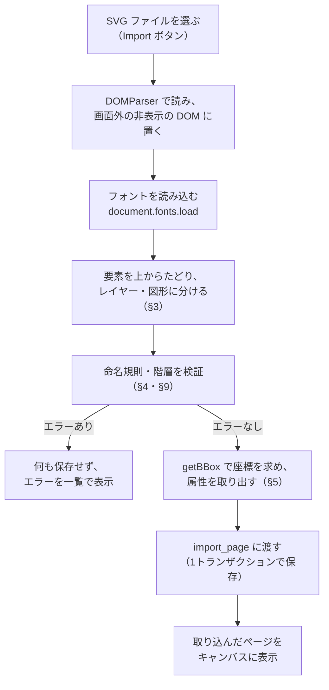
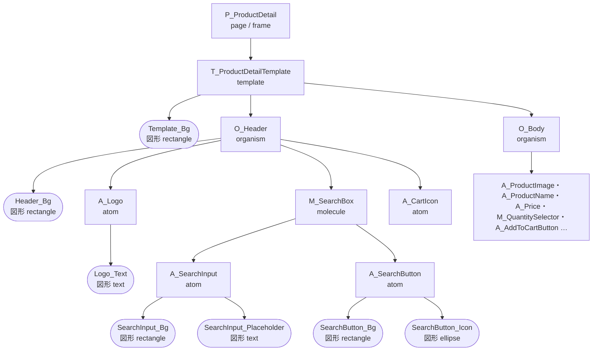

# SVG 取り込み仕様

Figma から書き出した SVG を、どう読み、どう本研究の6要素に分け、何をエラーにするかを決める。データの定義は [`docs/domain.md`](./domain.md)、保存の方法は [`docs/api.md`](./api.md) §6.2 を正とする。

Issue : [[決めること] SVG 取り込み仕様（命名規則・抽出する属性・エラー）](https://github.com/haana12332/FinalProject/issues/5)

---

## 1. Figma が書き出す SVG の特徴

実際に書き出した [`samples/valid/P_ProductDetail.svg`](./samples/valid/P_ProductDetail.svg)（商品詳細ページ、375×640）で確認した特徴。仕様はすべてこれを前提にする。

|特徴|SVG での見え方|取り込みでの扱い|
|---|---|---|
|レイヤー名は `id` になる|`<g id="O_Header">`、`<path id="Header_Bg">`|`id` をそのまま `layer_name` にする|
|フレーム・グループは `<g>` になり、**座標を持たない**|`<g id="A_Price">` に `x`・`y`・`transform` がない|中の図形の外接矩形から位置と大きさを求める（§5.1）|
|図形の座標は**ページ全体を基準にした絶対座標**|`Price_Text` の `<tspan x="16" y="388.546">`|親からの相対座標に直す（§5.1）|
|フレームの塗りは、id のない `<rect>` になる|`P_ProductDetail` の直下の `<rect width="375" height="640" fill="white"/>`|そのフレームの `fill` 属性にする（§5.2）|
|四角形（角丸を含む）も `<path>` になる|`SearchInput_Bg` は `M282 16H118C114.686 16 112 18.6863 …`|形から四角形・楕円を見分ける（§5.3）|
|日本語は文字参照になる|`&#x751f;&#x5354;…`|DOMParser が自動で文字に戻す|
|ページの外にはみ出す部分を切る|`<g id="P_…" clip-path="url(#clip0_…)">` と `<defs><clipPath>`|`defs` と `clip-path` は読まない|
|Auto Layout の設定は残らない|padding・gap・揃えの情報がない|取り込まない（`domain.md` の属性の定義どおり）|
|非表示のレイヤーは書き出されない|—|状態（ホバーなど）の表し方に影響する（§7）|

---

## 2. 取り込みの流れ



- パースはフロントエンドの `front/src/application/import`（#18）で行う。バックエンドは作らない。
- 1 SVG = 1 ページ。複数のページは、ページごとに書き出して1つずつ取り込む。
- エラーが1つでもあれば何も保存しない。**エラーはすべて集めてから**、一度に表示する（1つ直すたびに次のエラーが出る、を避けるため）。警告（§9.3）は表示するが、取り込みは続ける。

---

## 3. SVG の要素と6要素の対応

### 3.1 レイヤーと図形

SVG の要素を、次の2種類に分ける。

|種類|SVG の要素|判定|`layer_type`|`node_kind`|
|---|---|---|---|---|
|**レイヤー**（Atomic Design の要素）|`<g>`|`id` が `P_` / `T_` / `O_` / `M_` / `A_` で始まる|接頭辞から決まる（`page` など）|`frame`（id のない背景の `<rect>` を持つ）または `group`|
|**図形**（レイヤーの見た目を作る部品）|`<path>`・`<rect>`・`<circle>`・`<ellipse>`・`<text>`・`<image>`|接頭辞がない|**なし（`null`）**|形から決まる（§5.3）|

原子（`A_`）の中には、背景・文字・アイコンなど、見た目を作る図形が複数入る。例えば `A_SearchInput` は、背景の `SearchInput_Bg` と文字の `SearchInput_Placeholder` でできている。Figma のどの属性（塗り・文字サイズなど）も、レイヤーではなく図形が持つ。そこで図形もノードとして保存し、**設計時の判断は図形の属性にも付けられる**ようにする。

### 3.2 サンプルの対応



サンプル全体では、ノードは **37 個**（レイヤー 17、図形 20）になる。結果はすべて [`samples/valid/P_ProductDetail.expected.json`](./samples/valid/P_ProductDetail.expected.json) にある。

---

## 4. 命名規則と階層ルール

### 4.1 命名規則

1. **使える文字**：英字・数字・`_` だけ（`^[A-Za-z0-9_]+$`）。Figma は同じ名前のレイヤーに `_2` のような番号を付けることがあるので、数字も許す。
2. **接頭辞はレイヤー（`<g>`）にだけ付ける**：`P_`（ページ）/ `T_`（テンプレート）/ `O_`（有機体）/ `M_`（分子）/ `A_`（原子）。
3. **図形には接頭辞を付けない**：図形の名前は `{レイヤー名から接頭辞を除いたもの}_{役割}` を推奨する（例：`A_Price` の中の `Price_Text`）。推奨なので、守らなくてもエラーにはしない。
4. **すべての `<g>` に接頭辞が必要**：接頭辞のないグループは作らない。アイコンのように図形を複数まとめたいときは、Figma で1つの図形に結合（Flatten）するか、原子（`A_`）にする。
5. **最上位はページが1つだけ**：`<svg>` の直下にあるレイヤーは `P_` で始まる1つだけ。
6. **同じ名前**：兄弟の間で同じ名前があってもエラーにはしない（DB ではノードを `id` で区別するため）。ただし、取り込み直し（§8）では区別できなくなるので、同じ名前は避けることを推奨する。

### 4.2 階層ルール

レイヤー同士の親子は、`docs/db-schema.md` §4.2 の表に従う。図形の置き場所の規則をこれに加える。

|親 ＼ 子|template|organism|molecule|atom|図形|
|---|:-:|:-:|:-:|:-:|:-:|
|page|○|×|×|×|×（背景の `<rect>` だけは例外。§5.2）|
|template|×|○|○|○|○|
|organism|×|×|○|○|○|
|molecule|×|×|×|○|○|
|atom|×|×|×|×|○|
|図形|×|×|×|×|×|

- 「原子は子を持たない」は**レイヤーの子**を持たないという意味で、図形は持てる（持たないと見た目がない）。
- 図形は必ずレイヤーの中に置く。ページの外（`<svg>` の直下）に図形を置くことはできない。

---

## 5. 取り出す属性

### 5.1 位置と大きさ

1. SVG を画面外の非表示の DOM に置き、各要素の `getBBox()`（ページ基準の外接矩形）を取る。
2. **レイヤー**（`<g>`）の外接矩形は、中の図形をすべて囲む矩形になる（ブラウザが計算する）。
3. 保存する `x`・`y` は**親からの相対座標**＝自分の外接矩形の左上 − 親の外接矩形の左上。
4. **ページ**の `x`・`y` は `0`、`width`・`height` は `<svg>` の `width`・`height`。キャンバス上のページの位置は、取り込んだあとに #23 で動かす。
5. 数値は小数第2位で丸める。
6. `getBBox()` は線（stroke）の太さを含まない、図形そのものの矩形である。

**例**：`A_Price` の外接矩形はページ基準で (16, 369.55)、親の `O_Body` は (16, 80)。なので、`A_Price` の `x = 0`、`y = 289.55` になる。

**テキストの注意**：テキストの外接矩形は、フォントによって変わる。そのため、測る前に `document.fonts.load()` で使われているフォントを読み込む。日本語は Inter に字形がないので、ブラウザの日本語フォントで測られる。テストでテキストの位置と大きさを比べるときは、±2px の差を許す。

### 5.2 要素ごとの属性

|SVG の要素|`node_kind`|取り出す属性|
|---|---|---|
|`<g>`（レイヤー）|背景の `<rect>` があれば `frame`、なければ `group`|`x`・`y`・`width`・`height`、`opacity`（`opacity` 属性があるとき）。`frame` のときは背景の `<rect>` の `fill`・`stroke` も、このレイヤーの属性にする|
|id のない `<rect>`（レイヤーの直下）|— （ノードにしない）|親のレイヤーの背景として、上の `frame` の属性になる|
|`<path>`|`rectangle` / `ellipse` / `vector`（§5.3）|`x`・`y`・`width`・`height`・`fill`・`stroke`。`rectangle` は `corner_radius`、`vector` は `path`（`d` の値）|
|`<rect>`（id あり）|`rectangle`|`x`・`y`・`width`・`height`・`fill`・`stroke`・`corner_radius`（`rx`）|
|`<circle>`・`<ellipse>`|`ellipse`|`x`・`y`・`width`・`height`・`fill`・`stroke`|
|`<text>`|`text`|`x`・`y`・`width`・`height`・`characters`・`font_family`・`font_size`・`font_weight`・`letter_spacing`・`fill`（文字色）|
|`<image>`、画像の塗り（`fill="url(#pattern…)"`）|`image`|`x`・`y`・`width`・`height`・`image_ref`（§6.2）|

**取り出さない属性**：`text_align`・`line_height`（SVG に残らない）、padding・gap・レスポンシブ（Auto Layout は失われる）。これらは研究者が入力する。

### 5.3 図形の種類の見分け方

Figma は四角形も円も `<path>` で書き出すので、`d` の形から見分ける。

|`d` の形|`node_kind`|例|
|---|---|---|
|`M`・`H`・`V`・`Z` だけで、外接矩形の4辺に沿う|`rectangle`（`corner_radius = 0`）|`Header_Bg`：`M375 0H0V64H375V0Z`|
|`M`・`H`・`V`・`C`・`Z` で、直線（`H`・`V`）が外接矩形の4辺に沿い、角が曲線|`rectangle`（`corner_radius` ＝ 外接矩形の角から曲線の始まりまでの長さ）|`SearchInput_Bg`：角丸 6|
|直線がなく、曲線（`C`）4本だけでできている|`ellipse`|`SearchButton_Icon`（検索アイコンの円）|
|それ以外|`vector`（`d` をそのまま `path` に保存）|複雑なアイコン|

サンプルでは、20 個の図形が rectangle 10・text 9・ellipse 1 に分かれた。

### 5.4 値の変換

|SVG の値|保存する値|例|
|---|---|---|
|色の名前（`white`・`black`）|大文字の16進数|`white` → `"#FFFFFF"`|
|16進数の色|大文字にそろえる|`#1e3a5f` → `"#1E3A5F"`|
|`fill-opacity`|`fill` の `opacity`（なければ `1`）|`[{ "color": "#F2A623", "opacity": 1 }]`|
|`stroke-width`|`stroke` の `weight`（なければ `1`）|`[{ "color": "#9AA5B1", "weight": 1 }]`|
|`fill="none"`・`stroke` がない|その属性を作らない|—|
|`font-weight="bold"` / `"normal"` / なし|`700` / `400` / `400`|`bold` → `700`|
|`letter-spacing`（`em`）|px に直す（`em` × `font_size`）|`0em` → `0`|
|`<tspan>` が複数（複数行）|改行（`\n`）でつなぐ|—|
|文字参照（`&#x5546;`）|文字に戻す|`"商品を検索"`|

### 5.5 並び順（`sort_order`）

同じ親の中で、SVG に書かれている順に 0 から番号を振る。SVG では後ろの要素ほど手前に描かれるので、そのまま重なり順になる。背景の `<rect>`（ノードにしないもの）は数えない。

---

## 6. テキスト・画像・アイコン

### 6.1 テキスト

- 1つの `<text>` を1つの図形（`node_kind = text`）にする。`<tspan>` は分けない。
- 位置は `getBBox()` で求める（§5.1）。`<tspan>` の `y` は文字のベースライン（文字の下の線）なので、そのまま `y` にしない。

### 6.2 画像

- 画像は `image_ref` に、Supabase Storage に保存した先のパスを入れる。SVG の中に埋め込まれた画像データ（`data:image/png;base64,…`）を取り出して、Storage にアップロードする。
- 今回のサンプルの商品画像は、灰色の四角形と文字の仮の画像なので、画像は含まれていない。画像を含む SVG を書き出して確認してから、#18 で実装する。

### 6.3 アイコン

- 1つの図形でできたアイコンは、`rectangle` / `ellipse` / `vector` のどれかになる（§5.3）。
- 複数の図形でできたアイコンは、Figma で1つに結合（Flatten）してから書き出すか、アイコンを原子（`A_`）にして、その中に図形を置く。接頭辞のないグループは作らない（§4.1 の4）。

---

## 7. 別の状態（ホバー時など）の表し方（案）

Figma の SVG の書き出しでは、非表示のレイヤーは書き出されず、バリアント（状態）の情報も残らない。そこで、状態は次のように表す。

|状態の種類|表し方|例|
|---|---|---|
|ページ全体が変わる状態（モーダルを開いた後、など）|**別のページ**として書き出して取り込み、状態遷移リンクでつなぐ|`P_ProductDetail` → `P_ProductDetail_CartAdded`|
|部品の状態（ホバー、押下など）|同じ親の中に、`__{状態名}` を付けた**兄弟のレイヤー**として置き、表示した状態で書き出す|`A_AddToCartButton` と `A_AddToCartButton__hover`|

- `__` より前の名前が同じレイヤーを、同じ部品の別の状態とみなす。
- `__` の付いたレイヤーは、キャンバスに最初は描かない。プロトタイプ（#25）でトリガーが起きたときに、元のレイヤーの代わりに描く。状態遷移リンク（#24）の遷移先には、このレイヤーを選ぶ。
- 決まったら、`docs/domain.md` の未決事項（variant の持ち方）に反映する。

---

## 8. 同じページの取り込み直し（案）

`reimport_page`（`docs/api.md` §5）で、すでに取り込んだページを新しい SVG で置き換えるときの扱い。

1. **ノードの対応づけ**：ページからそのノードまでのレイヤー名の並び（例：`P_ProductDetail / T_ProductDetailTemplate / O_Body / A_Price / Price_Text`）が同じものを、同じノードとみなす。
2. **対応したノード**：ノードの `id` はそのまま残す。`source = figma` の属性だけを新しい値に置き換える。研究者が入力した属性（`source = manual`）と、設計時の判断はそのまま残る。
3. **新しくできたノード**：追加する。
4. **なくなったノード**：削除する。設計時の判断も一緒に消えるので、保存する前に「削除されるノードと、消える設計時の判断の数」を一覧で表示し、研究者が確認してから保存する。
5. **実験を始めたあと**（そのプロジェクトにセッションがあるとき）：取り込み直しはできるが、警告を出す。対応したノードの `id` は変わらないので、操作ログの `target_node_id` は残る。

ノードの `id` を保つことで、実験を始めたあとに直しても、ログと設計時の判断が失われにくくなる。

---

## 9. エラーと警告

### 9.1 エラーの形

エラーは `docs/api.md` §2.1 の `AppError` で返す。`details` に違反を1件ずつ入れる。

```json
{
  "code": "naming_violation",
  "message": "取り込めませんでした。2件の問題があります",
  "details": [
    {
      "code": "naming_violation",
      "rule": "group_without_prefix",
      "layer_name": "Header",
      "path": "P_Sample > T_Sample > Header",
      "message": "グループ「Header」に接頭辞がありません。P_ / T_ / O_ / M_ / A_ のどれかを付けてください"
    }
  ]
}
```

`path` は、ページからそのレイヤーまでの名前の並び。Figma で該当するレイヤーを探すときに使う。

### 9.2 エラーの一覧（取り込みを止める）

|code|rule|条件|メッセージ|
|---|---|---|---|
|`naming_violation`|`invalid_characters`|名前に英字・数字・`_` 以外がある|「{layer_name}」に使えない文字が含まれています。レイヤー名は英字・数字・_ だけにしてください|
|`naming_violation`|`group_without_prefix`|`<g>` の名前に接頭辞がない|グループ「{layer_name}」に接頭辞がありません。P_ / T_ / O_ / M_ / A_ のどれかを付けてください|
|`naming_violation`|`missing_id`|`<g>` に名前がない|名前のないグループがあります（{path}）。Figma でレイヤー名を付けてください|
|`naming_violation`|`prefix_on_shape`|図形の名前に接頭辞がある|図形「{layer_name}」に接頭辞が付いています。接頭辞はグループ（フレーム）にだけ付けてください|
|`naming_violation`|`root_not_page`|最上位のレイヤーが `P_` で始まらない|最上位のレイヤー「{layer_name}」がページ（P_）ではありません。ページのフレームを書き出してください|
|`naming_violation`|`no_page`|ページ（`P_`）がない|ページ（P_）がありません。ページのフレームを書き出してください|
|`naming_violation`|`multiple_pages`|ページ（`P_`）が2つ以上ある|ページが {n} 個あります（{layer_name}）。1つの SVG にはページを1つだけ入れてください|
|`hierarchy_violation`|`invalid_parent`|§4.2 の表で × の親子|{parent_layer_type} の下に {layer_type}（{layer_name}）は置けません|
|`hierarchy_violation`|`shape_outside_layer`|図形がページの外にある|図形「{layer_name}」がページの外にあります。ページのフレームの中に入れてください|

### 9.3 警告の一覧（取り込みは続ける）

|rule|条件|扱い|
|---|---|---|
|`unsupported_element`|`<use>`・`<mask>`・`<filter>`・`<line>`・`<polygon>` など、§5.2 にない要素|その要素を取り込まない|
|`unsupported_fill`|グラデーション（`fill="url(#linearGradient…)"`）|その塗りを取り込まない|
|`unnamed_shape`|名前のない図形（背景の `<rect>` 以外）|その図形を取り込まない|

---

## 10. サンプル

### 10.1 正常系

|ファイル|内容|期待する結果|
|---|---|---|
|[`samples/valid/P_ProductDetail.svg`](./samples/valid/P_ProductDetail.svg)|商品詳細ページ（Figma から書き出したもの）|エラー・警告なし。ノード 37 個。[`P_ProductDetail.expected.json`](./samples/valid/P_ProductDetail.expected.json) と一致する（`import_page` に渡す形。テキストの位置・大きさは ±2px まで許す）|

### 10.2 異常系

すべて、下の表のエラーが**1件だけ**出る。期待する結果は [`samples/invalid/expected.json`](./samples/invalid/expected.json) にある。

|ファイル|code|rule|対象のレイヤー|
|---|---|---|---|
|`invalid_characters.svg`|naming_violation|invalid_characters|`O_Header-Main`|
|`group_without_prefix.svg`|naming_violation|group_without_prefix|`Header`|
|`missing_id.svg`|naming_violation|missing_id|（名前のないグループ）|
|`prefix_on_shape.svg`|naming_violation|prefix_on_shape|`A_HeaderBg`|
|`root_not_page.svg`|naming_violation|root_not_page|`T_Sample`|
|`multiple_pages.svg`|naming_violation|multiple_pages|`P_First`, `P_Second`|
|`page_child_not_template.svg`|hierarchy_violation|invalid_parent|`O_Header`（page の下の organism）|
|`organism_in_organism.svg`|hierarchy_violation|invalid_parent|`O_Card`|
|`atom_has_layer_child.svg`|hierarchy_violation|invalid_parent|`A_Currency`（atom の下の atom）|
|`shape_outside_layer.svg`|hierarchy_violation|shape_outside_layer|`Stray_Bg`|

この仕様は、試作のパーサーをブラウザ（Chromium）で動かし、正常系・異常系のすべてのサンプルで上の結果になることを確かめて決めた。#18 では、これらのサンプルをそのままテストに使う。

---

## 11. 「Copy as SVG」のペースト

ペーストによる取り込み（旧 #22）は削除したので、この仕様の対象外とする。取り込みはファイルの選択だけで行う。

---

## 12. 他のドキュメントへの影響（要確認）

§3 の「図形」をノードとして保存するには、次の変更が必要になる。この PR がマージされたら、それぞれ直す。

|ドキュメント|変更|
|---|---|
|`docs/domain.md`|`Nodes.layer_type` を「レイヤーのとき必須、図形のときは `null`」にする。図形の定義を用語に足す|
|`docs/db-schema.md` §3.1|`nodes.layer_type` を NULL 可にする|
|`docs/db-schema.md` §4.1|`check ((layer_type = 'page') = (parent_node_id is null))` は、`layer_type` が `null` のとき判定が `null` になり、制約が効かない。`check ((layer_type is not distinct from 'page') = (parent_node_id is null))` に直す|
|`docs/db-schema.md` §4.2|トリガーに「図形の親は template・organism・molecule・atom のどれか」「図形は子を持たない」を足す|
|`docs/db-schema.md` §4.1|図形の `node_kind` は `group`・`frame` 以外、レイヤーの `node_kind` は `group`・`frame` だけ、という CHECK を足す|

---

## 13. 未決事項

- **図形をノードとして保存すること**（§3・§12）：この方法でよいか。
- **状態の表し方**（§7）：`__{状態名}` の兄弟のレイヤーでよいか。
- **取り込み直し**（§8）：レイヤー名の並びで対応づける方法でよいか。
- **画像**（§6.2）：画像を含む SVG を書き出して、埋め込まれ方を確認する。
